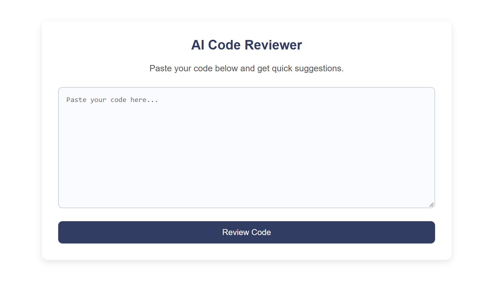
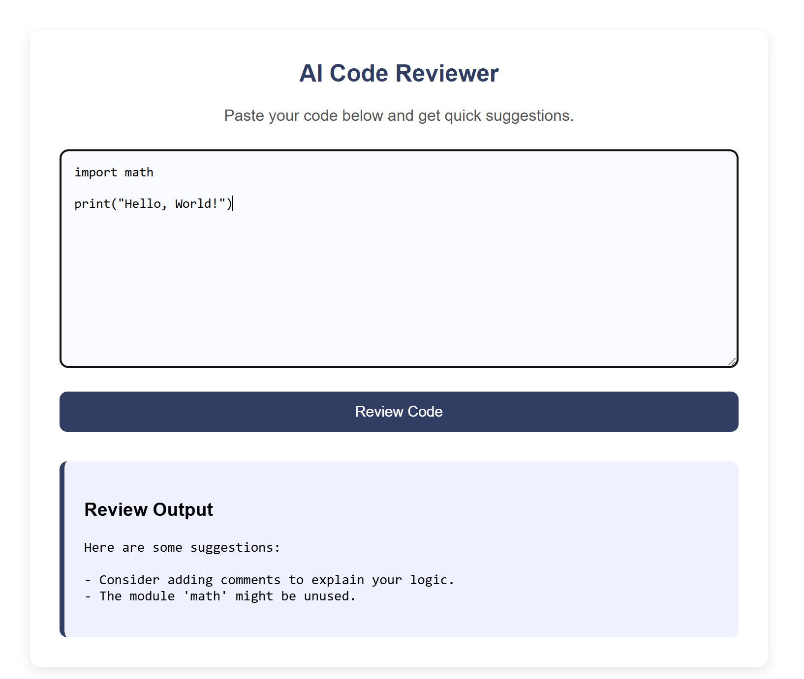

# AI Code Reviewer

A lightweight Flask web application that analyses Python code and provides instant feedback on common issues such as unused imports, indentation problems, missing comments, and readability concerns.
This project demonstrates backend logic, simple static + template integration, and clean modular Python design.

  FEATURES:

- Detects unused imports
- Highlights indentation inconsistencies
- Flags missing comments or docstrings
- Checks for long lines and readability issues
- Provides instant feedback through a clean web interface
- Fully responsive layout (mobile, tablet, desktop)
- Simple, fast, and easy to run locally

  STRUCTURE:

  .
  ├── README.md
  ├── app.py
  ├── requirements.txt
  ├── reviewer.py
  ├── static
  │   └── style.css
  |   └──screenshots
  │      ├── home_page.png
  │      └── output.png
  ├── templates
      └── index.html

  HOW TO RUN THE APP

 - Create and activate a virtual environment
   "python3 -m venv venv"
   "source venv/bin/activate"
 
 - Install dependencies
   "pip install -r requirements.txt"

 - Start the application
   "python app.py"

 - Open the app in your browser
   visit: http://127.0.0.1:5000 or 127.0.0.1

  SCREENSHOTS:

 - Homepage
    

 - Review output
    

  FUTURE IMPROVEMENTS:

 - Preserve code after review
   Currently, the code disappears from the textarea after clicking "Review Code".
   A future enhancement would keep the code visible so users can:
   - compare suggestions with their original code
   - make corrections directly in the textarea
   - re-run the review without re-pasting the code

  This would make the tool more practical for iterative improvements.
 - Highlight Problematic Lines
   Instead of showing plain text suggestions, the app could highlight:
   - long lines
   - unused imports 
   - indentation issues
   - missing comments 
  
  Directly inside the textarea or in a side-by-side view.
  This would make the feedback more intuitive and easier to follow.

 -Show line numbers for suggestions
  The current suggestions do not specify where the issue occurs.
  Adding line numbers would help users quickly locate and fix problems.
  This would make the feedback more actionable and reduce confusion.

PURPOSE OF THE PROJECT:

This project was built to practise:
- Flask fundamentals
- Modular Python design
- Basic static + template integration
- Code quality analysis logic
- Clean UI + backend integration

This project was created as a practical way to strengthen my Python and Flask skills while building something useful. 
Instead of focusing on advanced AI or complex analysis, I wanted a simple tool that demonstrates clean backend logic, 
modular code structure, and a responsive user interface. The tool reflects how developers improve code in real workflows, by reviewing feedback, making changes, and iterating until the code becomes cleaner and more readable.
It serves as a simple utility tool and a demonstration of backend + frontend integration.
  
TECH STACK:

- Python
- Flask
- HTML/CSS
- Jinja Templates

ADDITIONAL ENHANCEMENTS:

- Adding syntax error detection
- Add support for multiple languages
- Add downloadable review reports

AUTHOR:

Priyanshi Jadeja - Computer Science student at UWE Bristol.